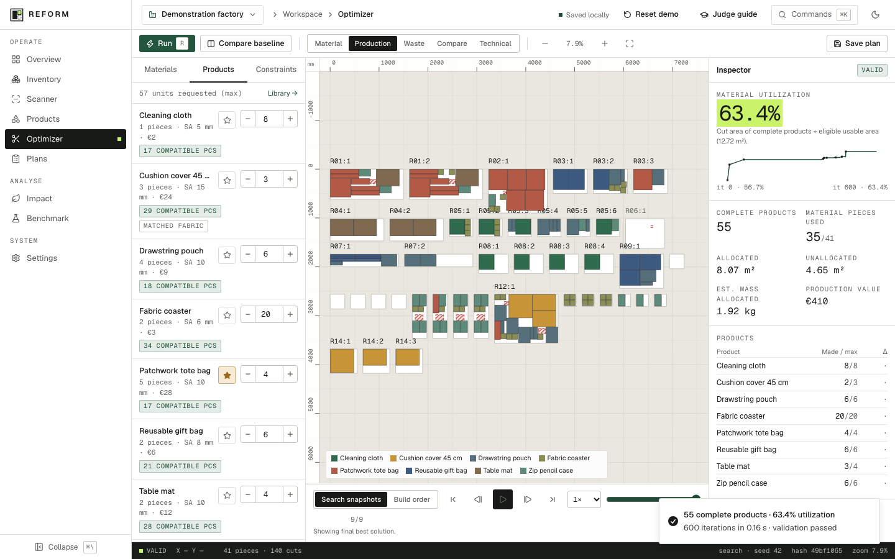

# REFORM

**Waste is a design constraint, not an endpoint.** — *Turn remnants into resources.*

REFORM is a computational material-recovery and manufacturing-optimization platform for textile remnants. It starts from discarded fabric — offcuts, roll ends, stained seconds, swatches — and computes which **complete** products can be cut from it, where every pattern piece goes, and how much material that recovers. Everything runs in the browser: no backend, no account, no API keys, no AI service.

```
Discarded material → Digital inventory → Product compatibility → Optimization → Manufacturing plan → Recovery measurement
```



## The problem

Pre-consumer textile waste is mostly still-good fabric, but every remnant differs in size, fibre, colour, grain and condition. Working out what each piece can still become is a hard multi-product 2D packing problem, so it is rarely done and the fabric is discarded. REFORM makes that decision computational, verifiable and fast. See [docs/IMPACT_METHODOLOGY.md](docs/IMPACT_METHODOLOGY.md).

## Features

- **Material inventory** — integer-mm storage with mm/cm/m entry, defects, grain, rotation rules, GSM, cost, reserve/consume, search/filter/sort, table and grid views, CSV import/export.
- **Scanner (optional)** — upload/drag a photo, 2-point or 4-corner (perspective-correcting) calibration, auto-detected or hand-traced outline, certified inscribed rectangle, confidence notes. Estimates only.
- **Pattern library** — 8 illustrative built-in products and a custom product editor (rectangular pieces, quantities, seam allowance, compatible fabrics, matched fabric, rotation/grain, preferred colours, preview).
- **Optimization engine** — First-Fit Shelf baseline, MaxRects (BSSF/BAF/BL/BLSF, split + prune), seeded multi-strategy search; transactional complete-product allocation; five objectives; Web Worker with real progress and cancellation; independent validator.
- **Manufacturing studio** — React Konva canvas with rulers, grid, zoom around cursor, pan, fit, hover and selection inspection; material / production / waste / comparison / technical views; playback of real solver snapshots and build order; live replanning with OUTDATED detection and per-product diff.
- **Production plans** — save with inventory snapshot; true-scale SVG, PDF report, CSV cut list, JSON project export/import; idempotent commit that deducts inventory once.
- **Benchmark laboratory** — eight deterministic datasets, identical inputs for all algorithms, re-validated layouts, side-by-side views, Markdown/JSON report.
- **Impact analytics** — utilization, allocated/net/unallocated area, mass from per-fabric GSM, replacement value, per-fabric/product breakdowns, proposed vs committed vs verified, formula drawer.
- **Workspace** — demo factory or empty start, multiple workspaces, command palette (⌘K), keyboard shortcuts, judge guide, light/dark, reduced motion, local persistence indicator.

## Quick start

```bash
cd reform
npm install
npm run dev          # http://localhost:3000
```
Production: `npm run build && npm start`. Node 20+ (tested on Node 24.15). Open `/workspace` and choose **Explore the demonstration factory**.

## Commands

| Command | Purpose |
|---|---|
| `npm run dev` | Development server |
| `npm run build` / `npm start` | Production build / server |
| `npm test` | Vitest unit + property tests |
| `npm run test:e2e` | Playwright end-to-end tests (builds into `.next-e2e`, serves on :3200; run `npx playwright install chromium` once) |
| `npm run typecheck` | `tsc --noEmit` |
| `npm run lint` | ESLint |
| `npm run benchmark` | Run all benchmarks and regenerate `docs/BENCHMARKS.md` |

## Architecture

```
app/            routes: /, /methodology, /workspace/{inventory,scanner,products,optimizer,plans,impact,benchmark,settings}
components/     UI (workspace shell, canvas, optimizer, inventory, products, analytics, landing, ui primitives)
core/           framework-free TypeScript: domain, geometry, optimization, impact, production, exports, vision
workers/        optimization Web Worker + protocol
stores/         Zustand stores (workspace, run)
lib/            Dexie DB, worker client, PDF, formatting, hooks
data/           synthetic demo factory and benchmark datasets
tests/          unit (Vitest) and e2e (Playwright)
scripts/        benchmark.ts
docs/           architecture, algorithms, impact, benchmarks, submission, demo script, judge guide, AI disclosure
```
Details and diagrams: [docs/ARCHITECTURE.md](docs/ARCHITECTURE.md).

## Optimization methodology

A constrained multi-bin, multi-product 2D packing problem. Clearance and edge margins are made exact by an inflated packing space; each product unit is allocated transactionally (clone → place all pieces → commit or roll back); the search explores 64 constructive strategies then bounded seeded local search over product order and mix. An independent validator re-derives every rule from the request and rejects any violating solution. See [docs/ALGORITHMS.md](docs/ALGORITHMS.md).

## Environmental impact methodology

Utilization = cut-pattern area of complete products ÷ eligible usable area (compatible material minus exact defect union). Mass is computed per material from its own GSM; value only where costs are known. Proposed allocation, committed consumption and physically verified recovery are reported separately; no carbon or water factors are applied. See [docs/IMPACT_METHODOLOGY.md](docs/IMPACT_METHODOLOGY.md) and the in-app `/methodology`.

## Results (synthetic data)

From `npm run benchmark` (seed 42, material objective, 400 search iterations) — full table in [docs/BENCHMARKS.md](docs/BENCHMARKS.md):

| Dataset | Shelf baseline | MaxRects | Search | Δ pts (search − shelf) |
|---|---:|---:|---:|---:|
| Demonstration factory | 49.46 % | 60.36 % | 64.02 % | +14.55 |
| Small tailoring shop | 58.79 % | 63.32 % | 66.55 % | +7.76 |
| Mixed remnant inventory | 50.55 % | 52.10 % | 65.99 % | +15.44 |
| Uniform fabric batch | 66.81 % | 86.54 % | 86.54 % | +19.73 |
| Fragmented textile inventory | 55.74 % | 57.15 % | 58.53 % | +2.79 |
| Defect-heavy fabric batch | 56.90 % | 63.91 % | 66.87 % | +9.98 |
| Rotation-restricted batch | 66.37 % | 64.40 % | 67.99 % | +1.62 |
| High-volume batch | 64.65 % | 67.63 % | 69.39 % | +4.74 |

Zero invalid placements in every run. The single-pass MaxRects is **worse** than the shelf baseline on the rotation-restricted set — reported as measured. Baseline and MaxRects use a canonical largest-product-first order so they do not depend on list order (tested). Product counts are in the full table.

## Testing

- `npm test` — 155 Vitest tests: geometry, units, MaxRects internals, every optimizer case for all three algorithms (empty inputs, oversize products, exact fits, rotation, grain, fabric compatibility, matched fabric, multiple instances, reserved stock, multi-piece products, defects, clearance/margins, seam allowance, demand limits, invalid input), transactional rollback, determinism, cancellation, time limits, objective switching, baseline order-independence, validator tamper detection, 40 random seeded problems × 3 algorithms, impact math (hand-calculated), commits and double-commit prevention, CSV/SVG/schema, benchmark harness, scanner vision.
- `npm run test:e2e` — Playwright: full workflow (demo → add remnant → create product → optimize → canvas → baseline → save plan → SVG/CSV/PDF export → commit + refused second commit → reload persistence → modify inventory → outdated → re-run) and the benchmark lab.

## Known limitations

- Rectangular pieces and 0°/90° rotation only; irregular pieces must be entered as enclosing rectangles.
- Heuristic search; no optimality guarantee. Search results are machine-dependent when the time limit binds before the iteration budget.
- Benchmarks run on the main thread of the worker per dataset; cancelling takes effect between datasets.
- Off-cuts are not automatically returned to inventory after a commit.
- Scanner measurements are estimates; fabric drape and lens distortion are not modelled.
- Data is per-browser (IndexedDB); no multi-user sync.
- Templates are illustrative; layouts need practical production verification.

## Roadmap

Polygon nesting (no-fit polygons), off-cut return, verified-recovery logging, guillotine mode, DXF export for cutting tables, multi-user sync, user-supplied labelled lifecycle factors.

## Deployment

Vercel-ready static/client app: no environment variables, no server functions, Web Worker bundled by Next.js. `vercel` from the `reform/` directory deploys it. (Not deployed by the build agent.)

## License & attribution

MIT — see [LICENSE](LICENSE). Third-party licenses: [docs/THIRD_PARTY_LICENSES.md](docs/THIRD_PARTY_LICENSES.md). AI assistance: [docs/AI_DISCLOSURE.md](docs/AI_DISCLOSURE.md). All demo data is synthetic.
