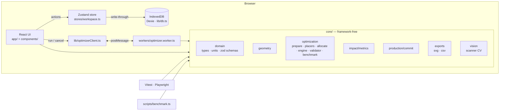
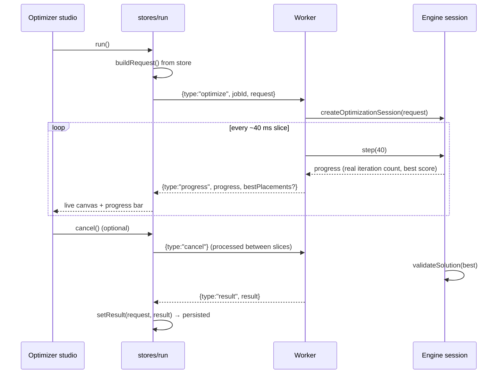

# Architecture

REFORM is a single Next.js (App Router) application that runs entirely in the browser. There is no backend: data lives in IndexedDB, and optimization runs in a Web Worker. The computational core (`core/`) is plain TypeScript with no React, DOM or browser dependency, so it runs identically in the worker, in Vitest and in the Node benchmark script.

## Modules

| Path | Responsibility |
|---|---|
| `core/domain/types.ts` | Domain model: `MaterialRemnant`, `MaterialInstance`, `ProductTemplate`, `PatternPiece`, `OptimizationRequest`, `OptimizationConstraints`, `Placement`, `CompletedProduct`, `OptimizationResult`, `IterationSnapshot`, `ImpactMetrics`, `BenchmarkResult`, `ProductionPlan`. |
| `core/domain/units.ts` | mm/cm/m conversion (stored as integer mm), area and mass helpers. |
| `core/domain/schemas.ts` | Zod runtime validation for remnants, products and project JSON import. |
| `core/geometry/rect.ts` | Intersection, containment, clearance separation, exact union area, polygon tests, view transforms (zoom around cursor, fit). |
| `core/optimization/prepare.ts` | Input validation, instance expansion (quantity − reserved), cut-piece expansion (seam allowance), orientation rules (rotation + grain), request hash. |
| `core/optimization/bins.ts` | Inflated packing space that makes clearance and edge margin exact. |
| `core/optimization/maxrects/` | MaxRects free-rectangle split / prune / scoring. |
| `core/optimization/placers.ts` | Placer interface (`init`, copy-on-write `clone`, `place`) with MaxRects and First-Fit Shelf implementations. |
| `core/optimization/allocate.ts` | Transactional complete-product allocation. |
| `core/optimization/objective.ts` | Objective modes and their formulas. |
| `core/optimization/engine.ts` | `createOptimizationSession` (time-sliced, cancellable) and synchronous `optimize`. |
| `core/optimization/validation/validator.ts` | Independent solution validator. |
| `core/optimization/benchmark*.ts` | Benchmark harness and Markdown report. |
| `core/impact/metrics.ts` | Area, utilization, mass, value, per-fabric and per-product breakdowns. |
| `core/production/commit.ts` | Idempotent plan commit (inventory deduction). |
| `core/exports/` | True-scale SVG cutting layouts; CSV cut list; inventory CSV import/export. |
| `core/vision/vision.ts` | Otsu segmentation, convex hull, homography, inscribed rectangle — scanner support. |
| `stores/workspace.ts` | Projects, inventory, products, plans, settings; persistence; request building. |
| `stores/run.ts` | Optimization run state (progress, live best layout, cancel). |
| `workers/` | Worker entry and message protocol. |
| `components/canvas/` | React Konva manufacturing canvas, layout, SVG thumbnails. |
| `lib/pdf.ts` | jsPDF manufacturing report (loaded on demand). |

## State management & persistence

`useWorkspace` (Zustand) holds the active project in memory. Every mutation updates state synchronously, then writes the changed record to IndexedDB (Dexie). A `pending` counter drives the "Saved locally / Saving…" indicator and a `beforeunload` guard.

IndexedDB schema (`reform` v1):

| Table | Key | Content |
|---|---|---|
| `projects` | `id` | name, kind (demo/custom), `settings` (demand, excluded remnants, constraints, objective, algorithm, search settings, last/previous/baseline results) |
| `remnants` | `projectId::id` | `MaterialRemnant` |
| `products` | `projectId::id` | `ProductTemplate` |
| `plans` | `projectId::id` | `ProductionPlan` (request snapshot + result) |
| `kv` | key | preferences, current project |

## Optimization pipeline

The engine yields between slices, so cancellation is processed promptly and the best valid intermediate result is returned. Worker crashes reject pending jobs and the worker is recreated on the next run.

**Outdated detection.** `requestHash(request)` fingerprints everything that affects the result (remnant geometry, available quantity, defects, products in demand, demand, constraints, objective, algorithm, search settings). The studio compares it with `result.inputHash`; on mismatch the canvas is dimmed, an OUTDATED banner appears and saving is disabled.

## Export pipeline

- **SVG** (`core/exports/svg.ts`): root `width/height` in `mm`, viewBox in mm, so 1 user unit = 1 mm; includes material boundaries, defects, piece outlines, IDs, grain arrows, 100 mm scale bar.
- **PDF** (`lib/pdf.ts`): jsPDF, vector layout diagrams, metrics, settings, validation, consumption, cut list, limitations.
- **CSV**: one row per placement.
- **JSON**: complete portable project (`format: "reform.project"`, version 1), validated with Zod before import; imports always create a new workspace.
